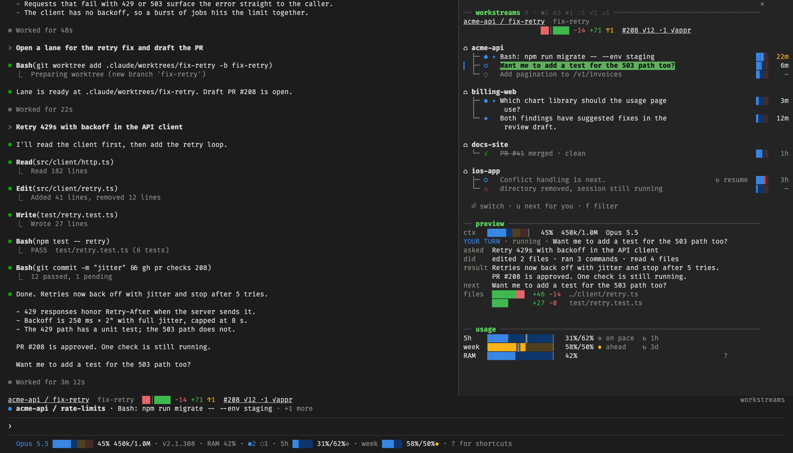

# workstreams

A Claude Code mod for triaging many parallel Claude Code sessions. It lists every session across your projects, puts the ones that need you first, and switches this tab into the one you pick.



*The panel docked on the right, the band and status line at the bottom. The sessions are demo data.*

It is a personal mod, built for one setup: macOS, cmux, and the `gh` CLI. Other setups work in part (see Requirements).

## What it adds

- **Panel** (ctrl+q or `/ws`): every session, grouped by project and sorted by urgency. The selected session's lane shows its branch, git diff, PR and checks, then a preview of its last turn and changed files. Usage pace meters and RAM sit at the bottom.
- **Band** above the prompt: this lane's folder, branch, git diff and PR, and a line naming the session that has waited on you longest.
- **Status line** under the prompt: model, context meter, version, RAM, 5-hour and week usage against pace, and counts of other sessions that need you or work.
- **Toast** when another session turns to need you.

## Requirements

- Claude Code with mod support.
- macOS. RAM reads `vm_stat` and `sysctl`.
- `git`. `gh`, signed in, for PR state and checks.
- cmux to switch sessions in place. Outside cmux, Enter copies the command to run.

## Setup

1. Clone this repo.
2. Load the mod in every session. In `~/.claude/settings.json`:

   ```json
   { "env": { "CLAUDE_CODE_PLUGIN_DIRS": "/path/to/cc-workstreams" } }
   ```

   Remove any `statusLine` entry: the mod draws the status line.
3. Bind ctrl+q to open and close the panel. In `~/.claude/keybindings.json`:

   ```json
   {
     "bindings": [
       { "context": "Global", "bindings": { "ctrl+q": "app:toggleDiffPreSession" } },
       { "context": "Pane", "bindings": { "ctrl+q": "pane:close" } }
     ]
   }
   ```

4. Restart open sessions with `/exit`. A session started before the setting runs without the mod.

Each saved edit in the checkout reloads the mod in every open session.

## Panel keys

| Key | Does |
|---|---|
| ⏎ | Switch to the session, or resume a stopped one |
| ↑/↓, Tab, j/k | Move |
| n/p | Next or previous project |
| u | Next row that needs you or is unread |
| f | Filter: all, needs you, working, stopped |
| w | Wrap the lane through the `/wrap` skill |
| x | Stop, then delete, a session (asks y/n) |
| c | Start a background session in this project |
| h | Toggle key help |
| esc, ctrl+q | Close |

## Options

`motion` (`/config`): `on` (default), `calm` (no flash or meter slide), or `off`.

## Layout

- `hooks/register.tsx`: all hooks, the panel, band and status line.
- `hooks/lead.tsx`, `hooks/meter.tsx`: animated row lead and meter (`Client` modules).
- `types/index.d.ts`: the session record and panel types.
- `docs/design.md`: the design and the reasons behind it. Read it before changing behavior.
- `docs/mock.html`: a mock of every panel state. `docs/gauges.html`: the gauge designs. Both predate the build, and `design.md` wins where they differ.

## Test

```sh
claude plugin test .
```

Each session writes its state to `~/.claude/workstreams/<sessionId>.json`. See Data in `docs/design.md`.
